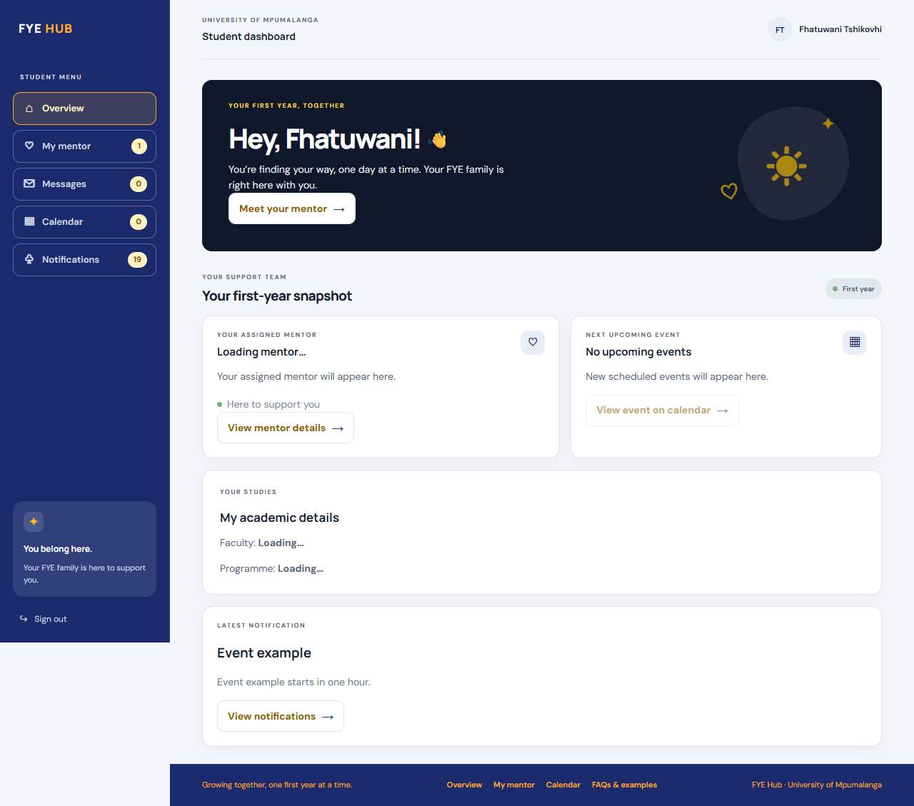

# FYE Hub

A role-based student support platform for first-year students, mentors, supervisors, and administrators. Built around the University of Mpumalanga's First Year Experience programme, it brings mentorship, communication, events, and programme management into one application.

**My role — Project lead & primary contributor.** I defined the feature direction, contributed the majority of the implementation, and guided the access controls and approval workflows across the platform.

**Stack:** JavaScript · HTML & CSS · Node.js · Express · Supabase · PostgreSQL

[Screenshots](docs/SCREENSHOTS.md) · [Case study](docs/CASE_STUDY.md) · [Architecture](docs/ARCHITECTURE.md) · [Setup](docs/SETUP.md)

## Features

| Workspace | Capabilities |
| --- | --- |
| Student | Assigned mentor, private messaging, calendar, notices, and event check-in |
| Mentor | Student support, contact tracking, profile management, and event requests |
| Supervisor | Application review, mentor assignments, event approvals, and attendance oversight |
| Admin | Account controls, academic catalogue, announcements, and analytics |

## Application preview

| Student | Mentor |
| --- | --- |
|  |  |

| Supervisor | Admin |
| --- | --- |
|  |  |

Screenshots show the running application using demo accounts. [Explore the desktop, mobile, and feature gallery →](docs/SCREENSHOTS.md)

## Engineering highlights

- Shared authentication resolves account roles and active mentor appointments.
- PostgreSQL functions and row-level policies support assignments, messaging, approvals, and attendance rules.
- Event workflows cover requests, review, publication, cancellation, completion, and reporting.
- Automated tests cover authentication, academic lifecycle rules, permissions, and dashboard behaviour.

## Run locally

Requires Node.js 22+ and a compatible Supabase project. Configure `.env` from `.env.example`, then:

```sh
npm ci
npm start
```

Open **http://localhost:3000**. See [setup instructions](docs/SETUP.md) for configuration and database prerequisites.

```sh
npm test          # Regression tests
npm run test:e2e  # Browser checks
```

## Licence

[MIT](LICENSE).
