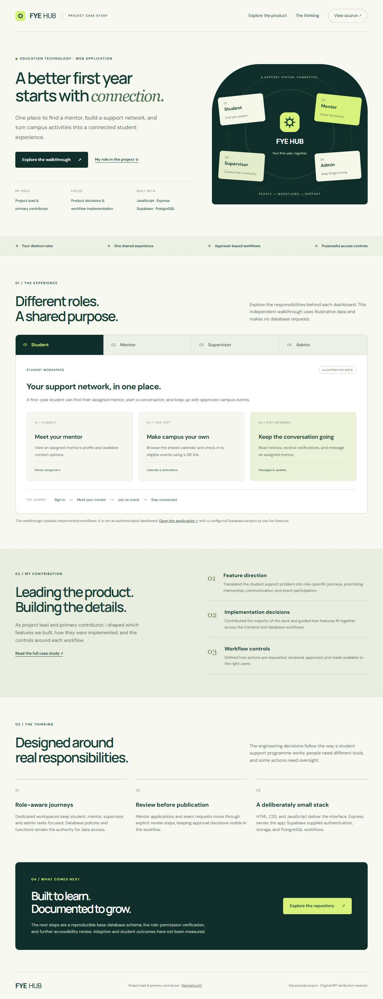
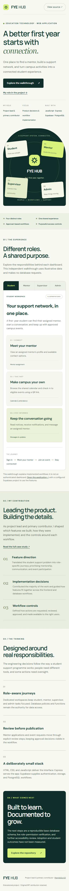
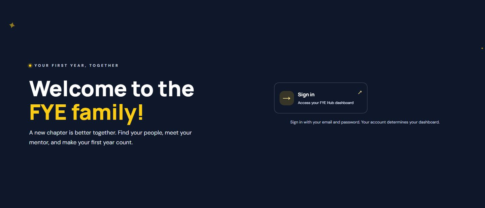
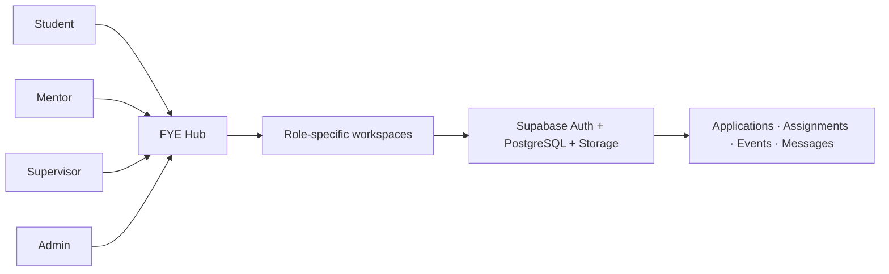

<p align="center"></p>

<p align="center">
  <a href="#explore-the-project">Explore</a> ·
  <a href="docs/CASE_STUDY.md">Case study</a> ·
  <a href="docs/SETUP.md">Setup guide</a> ·
  <a href="docs/ARCHITECTURE.md">Architecture</a> ·
  <a href="docs/PORTFOLIO_KIT.md">CV &amp; interview kit</a>
</p>

# FYE Hub

**A student support platform connecting first-year students, mentors, supervisors, and administrators.**

Starting university involves more than attending classes. Students need people to turn to, activities to join, and a clear place to find support. FYE Hub brings mentorship, communication, and programme coordination into one role-based web application, built around the First Year Experience context at the University of Mpumalanga.

**My role:** Project lead and primary contributor. I contributed the majority of the work, decided which features to build, and guided how they were implemented and controlled. This repository presents the project for technical and leadership review. Original authorship and the MIT licence are preserved; this is an educational project, with no claim of university endorsement.

| Product | Engineering | Leadership |
| --- | --- | --- |
| Four role-specific workspaces | JavaScript, Express, Supabase, PostgreSQL | Feature definition and prioritisation |
| Mentorship and communication | Database functions and access policies | Implementation and control decisions |
| Events, reviews, and attendance | Regression tests and documented workflows | Coordinating a connected user experience |

## Explore the project



The portfolio walkthrough is a separate, interactive case study with four selectable role journeys. It uses illustrative content, requires no account, and makes no Supabase requests. It explains the product rather than simulating a signed-in production session.

```sh
npm ci
npm start
```

Open **http://localhost:3000/portfolio.html**. Requires Node.js 22 or newer. No database configuration is needed for this page.

The application itself starts at **http://localhost:3000**. Live sign-in and dashboard actions require an existing compatible Supabase database; see the [setup guide](docs/SETUP.md). This repository does **not** yet include a complete base schema for an empty database.

<details>
<summary>Mobile presentation</summary>



</details>

<details>
<summary>Application entry screen</summary>



This is the application's entry screen. Authenticated dashboards require a configured database and authorised test accounts.

</details>

## What the platform does

| Role | Main responsibilities | Implementation entry point |
| --- | --- | --- |
| Student | Find an assigned mentor, send messages, view notices and events, check in through attendance links, apply for mentorship when eligible | [student.html](public/student.html) |
| Mentor | Support assigned students, record contact, maintain a profile, propose events, submit event outcomes | [mentor.html](public/mentor.html) |
| Supervisor | Review applications, assign students, review and manage events, oversee attendance and contact alerts | [supervisor.html](public/supervisor.html) |
| Admin | Manage faculties, programmes, mentor account controls, notices, and operational analytics | [admin.html](public/admin.html) |

One shared sign-in resolves the user's account and current role. Browser routing supports the experience; PostgreSQL functions, storage policies, and row-level security must enforce the actual permissions.



## Decisions worth discussing

- **Responsibilities shape the interface.** Each role gets a focused workspace while using shared authentication, academic, calendar, and communication modules.
- **Review is part of the product.** Mentor applications and event requests have explicit approval paths instead of immediate publication.
- **Important changes belong in database workflows.** Assignment, messaging, attendance, and account-control RPCs apply rules near the data.
- **The frontend stays approachable.** Plain HTML, CSS, and JavaScript keep the interface readable. Express serves static assets and exposes an allowlisted public runtime configuration.
- **Presentation works independently.** Recruiters can explore the case study without credentials or access to student records.

See the [case study](docs/CASE_STUDY.md) for the problem, contribution, tradeoffs, and interview talking points, and the [architecture notes](docs/ARCHITECTURE.md) for concrete module and database boundaries.

## Run and verify

```sh
npm test                 # Existing regression suite plus runtime-config checks
npx playwright install chromium
npm run test:portfolio   # Desktop/mobile walkthrough and unconfigured sign-in
npm run screenshots     # Recreate the checked-in presentation screenshots
```

On Windows, the browser checks use installed Microsoft Edge; Chromium is used elsewhere. Override with `PLAYWRIGHT_CHANNEL=chrome` or `PLAYWRIGHT_CHANNEL=chromium` as appropriate. [Verification details and limits](docs/VERIFICATION.md).

## Project map

```text
public/                 App pages, shared browser modules, portfolio walkthrough
database/               Existing-schema migrations and demo installation tooling
scripts/demo/           Administrative audit, preview, seed, and cleanup tooling
tests/                  Node regression tests
e2e/                    Portfolio browser checks
docs/                   Setup, architecture, case study, portfolio kit, screenshots
server.js               Static server and public runtime configuration
```

## Current status

The source contains implemented workflows and automated regression checks. Live deployment state, RLS enforcement, adoption, student satisfaction, and retention outcomes have not been verified by the portfolio presentation. Planned demo cohort sizes in existing handoff files are **plans, not measured user adoption**.

Next priorities: export a reproducible base schema, verify all role boundaries on an authorised test database, review accessibility across authenticated pages, and improve Unicode PDF export. Notifications and messages currently poll; push delivery and realtime subscriptions are future work.

## Attribution

MIT licensed; see [LICENSE](LICENSE). Original copyright: **2026 Mduduzi-sudo**. Portfolio presentation and project-lead statement: [MamilaGun23](https://github.com/MamilaGun23), based on the contributor's stated role. Existing project history and attribution remain intact.
