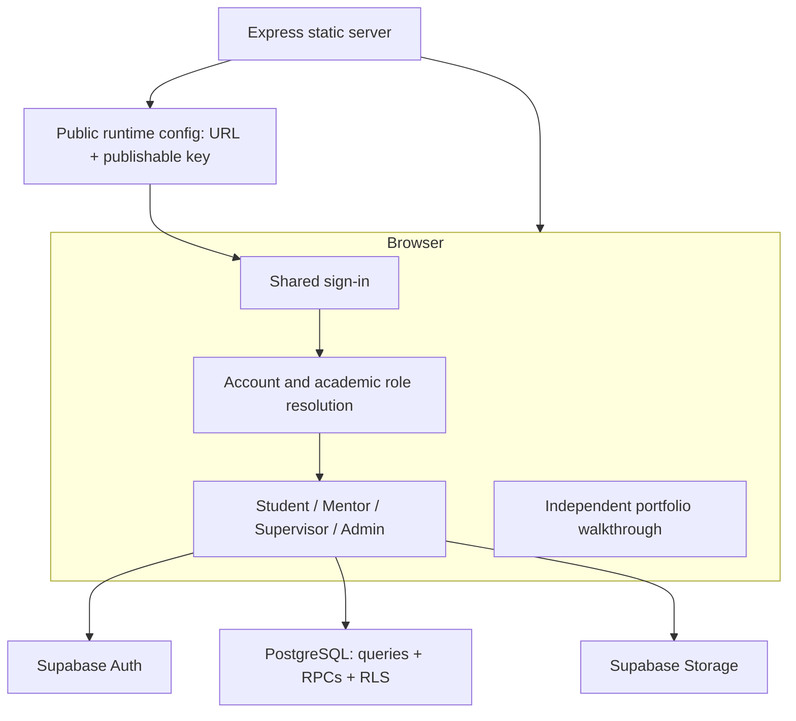
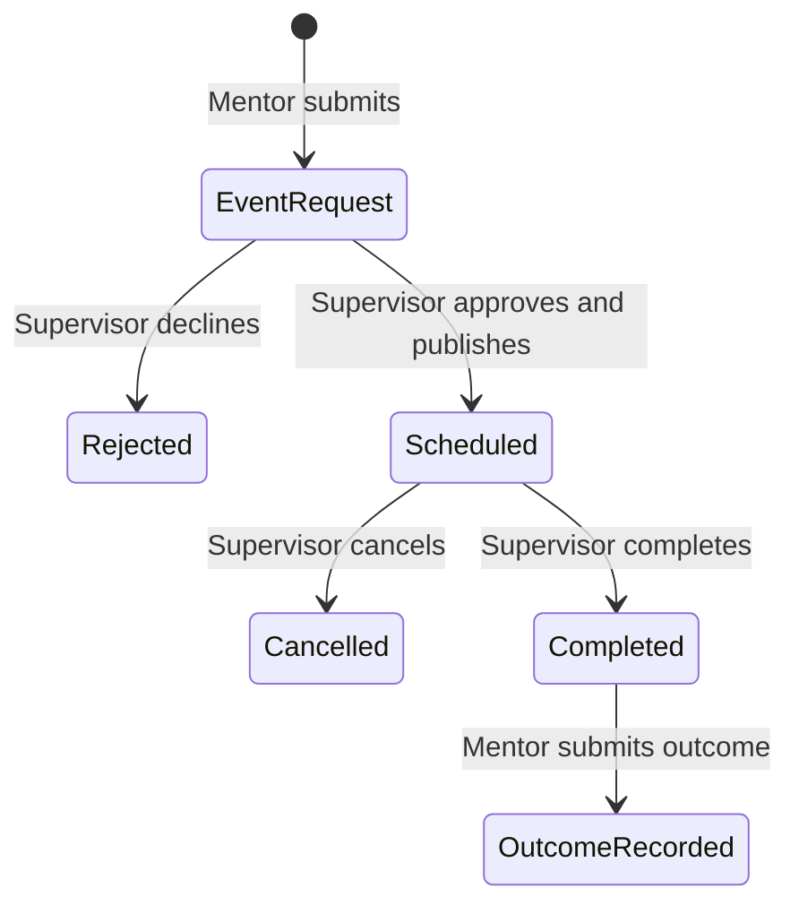
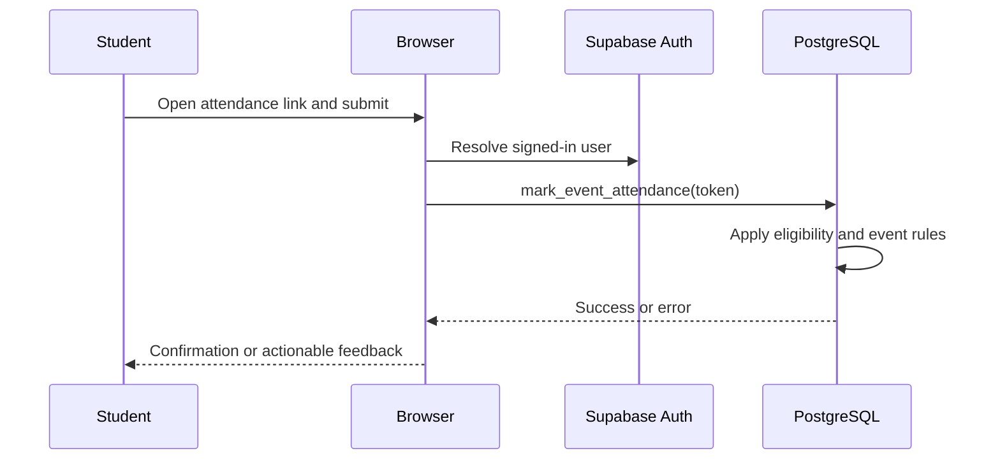

# Architecture and workflow boundaries

## Runtime

Express serves `public/` and an allowlisted `/runtime-config.js` response. Browser scripts connect directly to Supabase for authentication, PostgreSQL queries/RPCs, and file storage. Express is not a proxy for business operations and does not enforce database permissions.

The portfolio page is independent: `portfolio.html`, `portfolio.css`, `portfolio.js`, and a small SVG mark. Role switching changes local explanatory content only.

## Module map

| Concern | Main files |
| --- | --- |
| Authentication and routing | `auth.js`, `script.js`, `supabase-config.js` |
| Academic and appointment state | `academic.js`, `academic-details.js`, `academic-supervisor.js` |
| Student and mentor workspaces | `student.js`, `mentor.js`, `directory.js`, `mentor-application.js` |
| Assignments and approvals | `supervisor.js`, `supervisor-approvals.js` |
| Event lifecycle and attendance | `calendar.js`, `event-workflow.js`, `event-attendance.js`, `manual-attendance.js` |
| Communication | `messages.js`, `notices.js`, `notifications.js`, `supervisor-notifications.js` |
| Administration | `admin.js`, `admin-academic.js`, `admin-notices.js` |
| Common presentation | `dashboard-ui.js`, `dashboard-counts.js`, `ui-theme.css`, page styles |

Browser modules use shared globals such as `window.fyeSupabase` and `window.fyeAuth`; dependency order in the HTML matters. Runtime configuration must load before Supabase client creation, followed by shared authentication/academic modules and page scripts.

## Representative workflows

This is a simplified product diagram, not a literal enum map. Detailed constraints, timestamps, attendance eligibility, and audit behavior live in the SQL and event modules.

## Access and data handling

- The publishable key is public browser configuration. Service-role credentials are not exposed by the server endpoint and belong only in separate administrative tooling.
- Interface hiding and role redirects are not security boundaries. Authenticated SQL functions, row-level security, and storage policies must reject unauthorised operations.
- Mentor-student communication is tied to assignment workflows; application evidence and mentor photos use storage buckets with separate access requirements.
- Messages and notifications poll. No realtime transport is implied by the portfolio presentation.
- The complete base database schema is missing. Checked-in updates cannot independently establish that a deployed project's policies and schema are correct.

## Tradeoffs and next steps

The small stack makes source review approachable, but global browser modules create load-order coupling. A reproducible schema baseline, deployment-state validation, stronger module boundaries, accessibility review, and Unicode-safe exports are useful next improvements. See [verification](VERIFICATION.md) for what has actually been checked.
