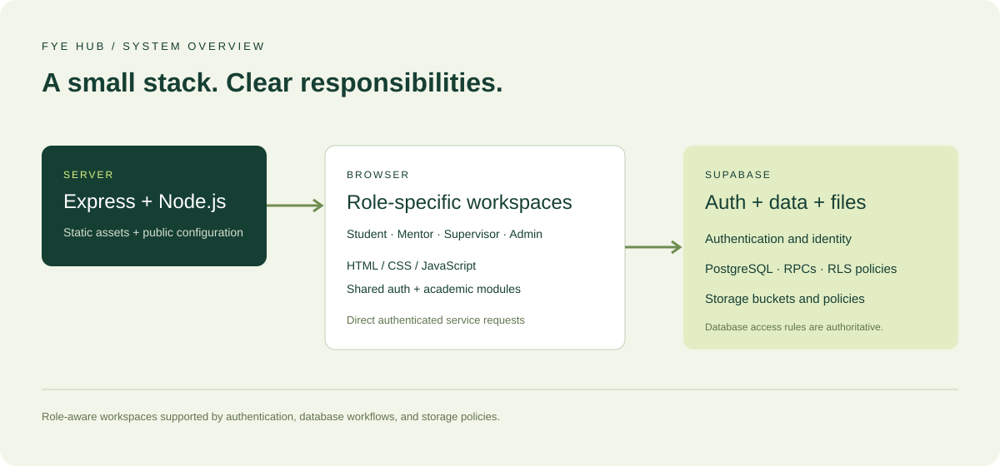
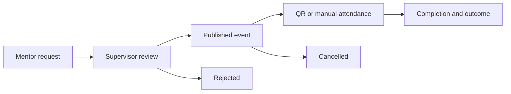

# Architecture

Express serves the frontend and public runtime configuration. Browser modules connect directly to Supabase Auth, PostgreSQL, and Storage. Database functions and row-level policies enforce access to application data.

## Main modules

| Concern | Entry points in `public/` |
| --- | --- |
| Authentication and academic status | `auth.js`, `academic.js` |
| Role workspaces | `student.js`, `mentor.js`, `supervisor.js`, `admin.js` |
| Applications and assignments | `mentor-application.js`, `supervisor-approvals.js`, `academic-supervisor.js` |
| Events and attendance | `calendar.js`, `event-workflow.js`, `event-attendance.js`, `manual-attendance.js` |
| Communication | `messages.js`, `notices.js`, `notifications.js` |
| Administration | `admin-academic.js`, `admin-notices.js`, `admin-details.js` |

Shared modules use browser globals, so HTML script order matters: runtime configuration, Supabase client, shared authentication/academic modules, then workspace scripts. Messages and notifications currently use polling.

## Event workflow

## Access controls

The server exposes only the Supabase URL and publishable key through `/runtime-config.js`. Role-aware navigation organises the interface; SQL functions, row-level security, and storage policies remain the authority for permissions. Administrative service keys are restricted to local demo-management tools.

Tests combine DOM fixtures, isolated PostgreSQL contract checks, and browser smoke checks. Live policy validation and a reproducible base schema remain areas for further work.
