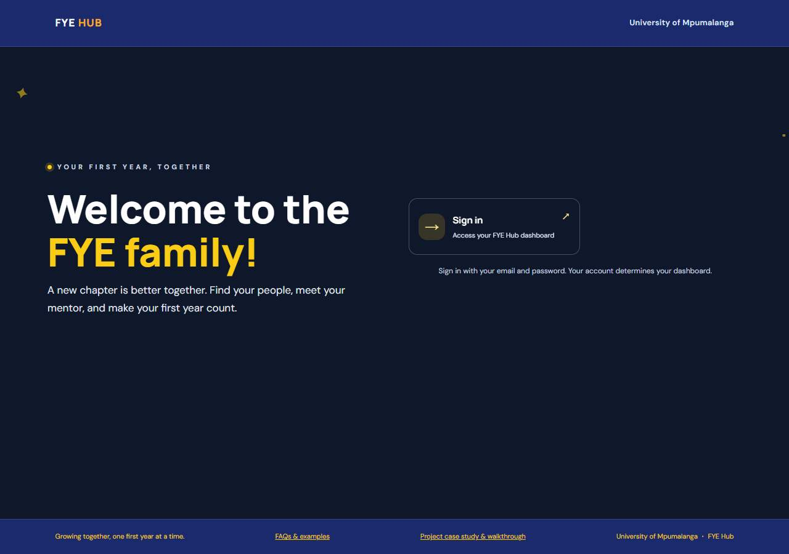

# FYE Hub — project leadership and product development

**Role:** Project lead and primary contributor 
**Context:** Educational student support web application 
**Stack:** HTML, CSS, JavaScript, Node.js, Express, Supabase, PostgreSQL 
**Repository:** [MamilaGun23/fye-hub-MDU2](https://github.com/MamilaGun23/fye-hub-MDU2)

## The problem

A first-year support programme has several connected responsibilities: students need guidance, mentors need a manageable way to support students, supervisors need oversight, and administrators need reliable programme controls. Fragmented communication and coordination make those journeys harder to follow.

FYE Hub explores how a shared platform can organise those responsibilities. It is built around a University of Mpumalanga First Year Experience context; it is not presented as an officially endorsed university service.

## My contribution

I was the project lead and contributed the majority of the work. I decided which features the project should include, guided implementation choices, and defined how workflows should be controlled. My responsibility connected product direction with implementation across the system.

The leadership statement above is provided by the contributor. The repository contains contributions and original MIT attribution from others; it does not imply that I authored every file or worked alone. Exact per-file ownership and contribution percentages have not been established.

## Turning the problem into a product

| Need | Product response | Evidence in the source |
| --- | --- | --- |
| Students need a clear route to support | Assigned mentor profiles, contact options, private messaging | `public/student.js`, `public/messages.js` |
| Mentors need to coordinate their support | Assigned-student views and contact recording | `public/mentor.js`, `database/20261007000000_mentor_communication_and_contact.sql` |
| Mentor appointment needs review | Application evidence, supervisor review, academic-cycle workflows | `public/mentor-application.js`, `public/supervisor-approvals.js`, `public/academic.js` |
| Activities need oversight | Event requests, review, publication, cancellation, completion, and outcomes | `public/event-workflow.js`, `public/calendar.js` |
| Participation needs a record | QR-link check-in and controlled manual attendance | `public/event-attendance.js`, `public/manual-attendance.js` |
| Programme management needs structure | Faculty/programme management, notices, account controls, analytics | `public/admin.js`, `public/admin-academic.js`, `public/admin-notices.js` |

## Three design decisions

### 1. One sign-in, role-aware workspaces

Users sign in through a shared entry point. Account resolution determines the destination and considers active status and academic mentor status. This keeps role selection out of the sign-in decision and makes the account state the basis for navigation.

The browser is a convenience layer. Database permissions must independently prevent unauthorised reads and writes. A role-aware interface alone is not evidence of a secure backend.

### 2. Approvals as explicit product steps

Mentor applications and mentor-proposed events require review. Approval and publication are separate stages with different responsibilities. The resulting workflow makes oversight a visible part of the experience rather than a hidden administrative task.

This introduces more states and exception paths to handle. It also provides a clearer model for rejection, cancellation, completed events, and attendance corrections.

### 3. A small frontend with database-backed rules

The interface uses plain JavaScript and shared modules. Express serves the frontend. Supabase supplies authentication, storage, and PostgreSQL functions and policies.

This reduces framework complexity, but shared globals and script load order need discipline. The next architectural improvement would be stronger module boundaries as the frontend grows. Migration reproducibility is also unfinished: the checked-in SQL assumes a foundational database that is not fully included.

## What can be demonstrated today

- Source-level implementations of four role-specific workspaces and their workflows.
- Regression tests covering authentication, assignments, academic lifecycle rules, attendance, notifications, and presentation behavior; see the verification report for the latest run.
- A responsive portfolio walkthrough with four selectable journeys, running without a database or login.
- Setup guidance, architecture diagrams, reproducible presentation screenshots, and a documented boundary between public browser configuration and administrative tooling.

The portfolio walkthrough uses illustrative content. It does not prove live database correctness, usage, or educational impact. Existing demo seed targets must not be quoted as real users.

## What I would improve next

1. Export and document the complete baseline schema so a fresh project can be reproduced reliably.
2. Exercise all role boundaries against a separate authorised test database, including negative permission cases.
3. Review keyboard, mobile, and screen-reader behavior across every authenticated workspace.
4. Improve Unicode support in PDF export and consider realtime delivery where polling becomes a constraint.
5. Agree on product measures before a pilot: time to assignment, mentor response time, event participation, and student feedback. These are proposed measures, not reported results.

## Interview explanation

> I led FYE Hub, a student support platform with student, mentor, supervisor, and admin workspaces. I contributed most of the implementation and directed feature choices and workflow controls. The most useful design challenge was deciding who could request, approve, publish, and manage each action, then expressing those responsibilities in both the interface and database workflows. The project shows my ability to connect product thinking, leadership, and implementation, while being clear about what still needs live validation.
