# Application gallery

Captured from the running application using demo accounts. Names and totals represent prototype data.

## Student

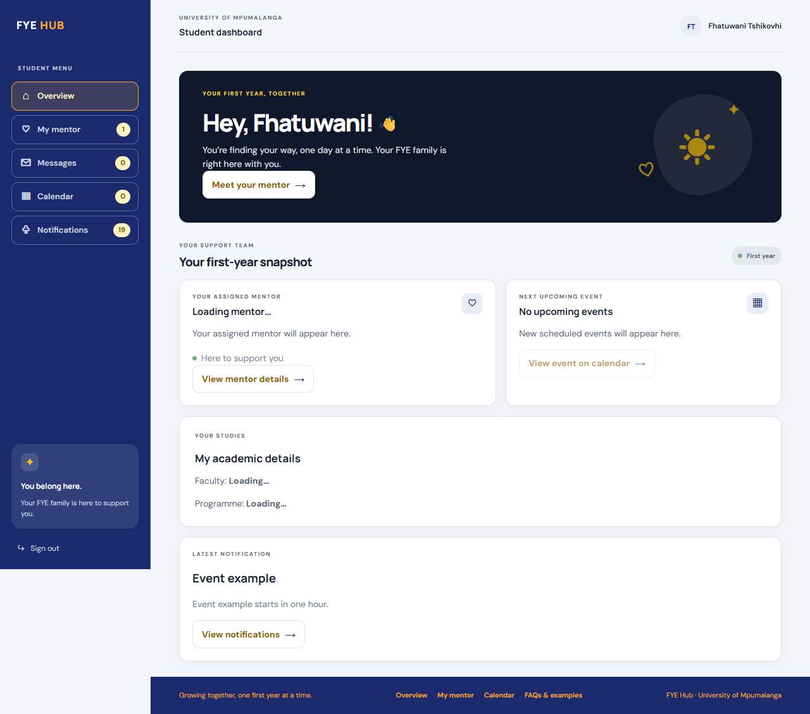

## Mentor

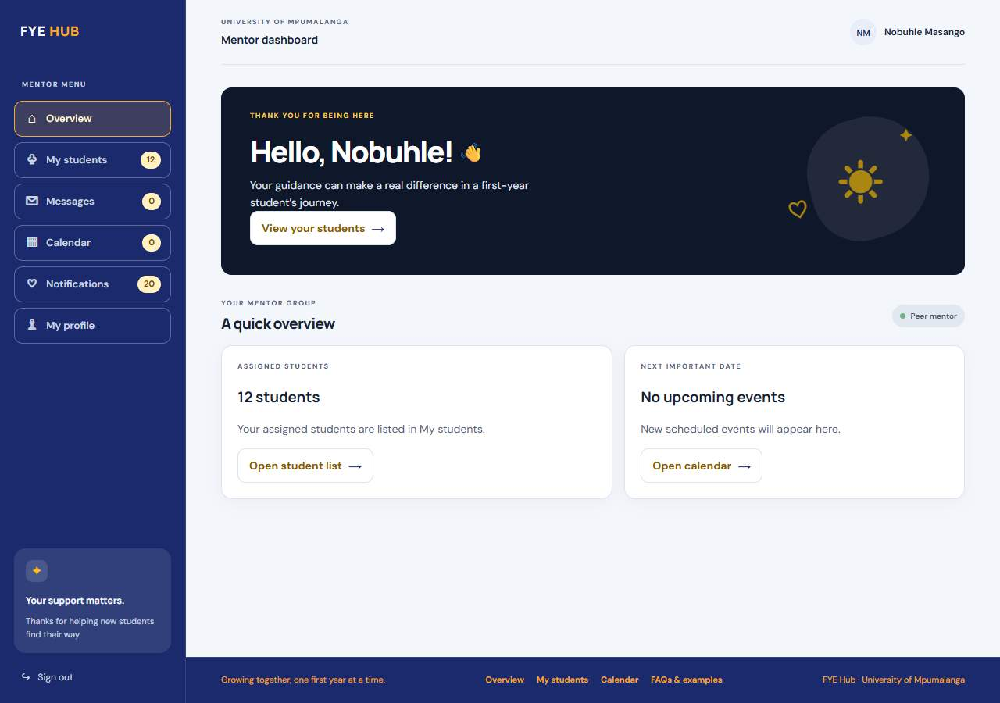

## Supervisor

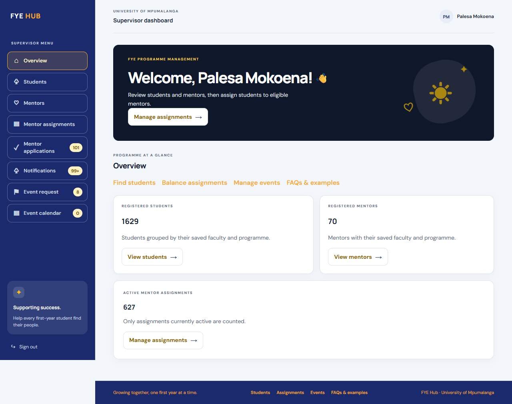
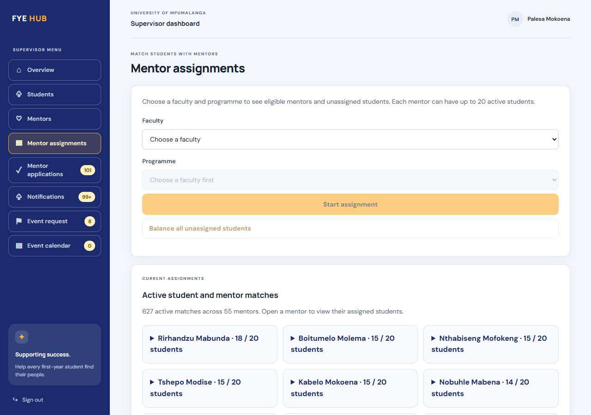

## Admin

## Welcome and sign-in

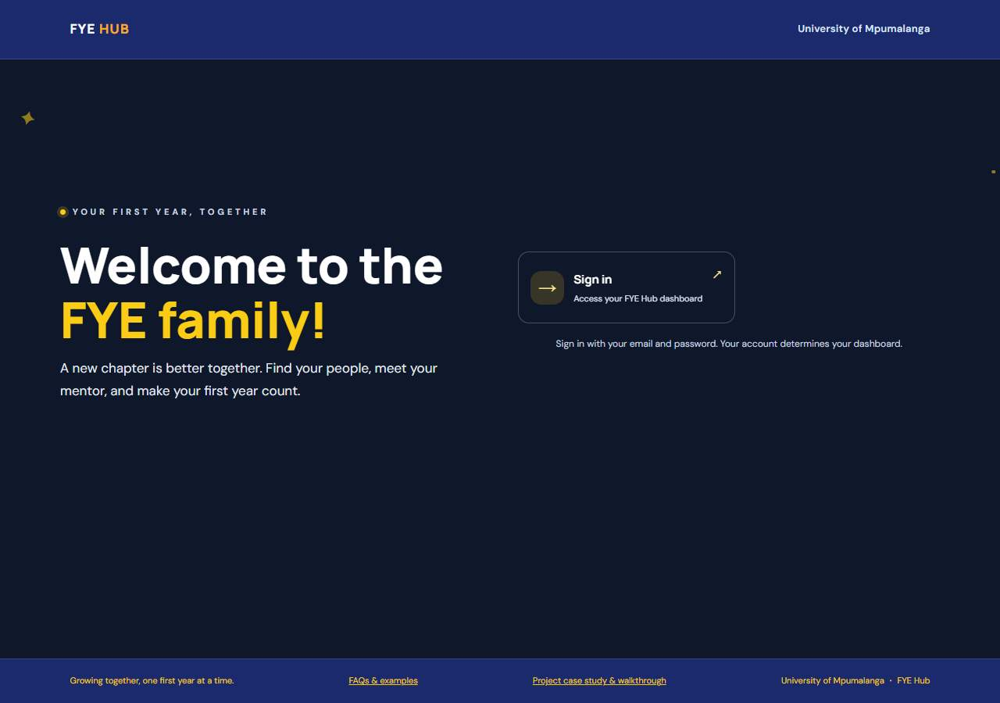
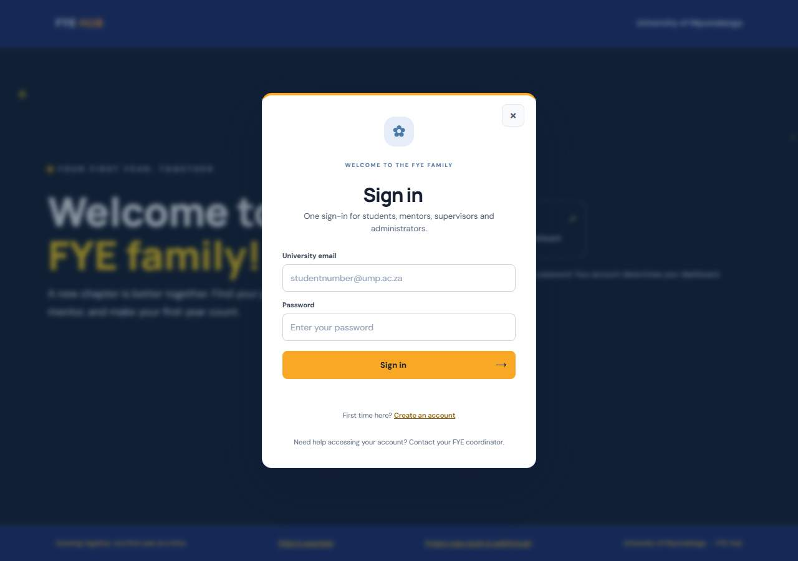
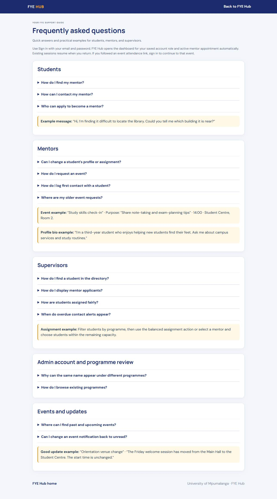

## Mobile

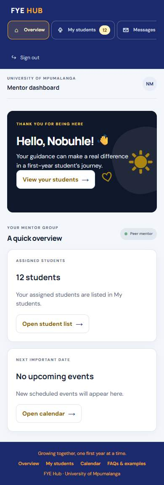
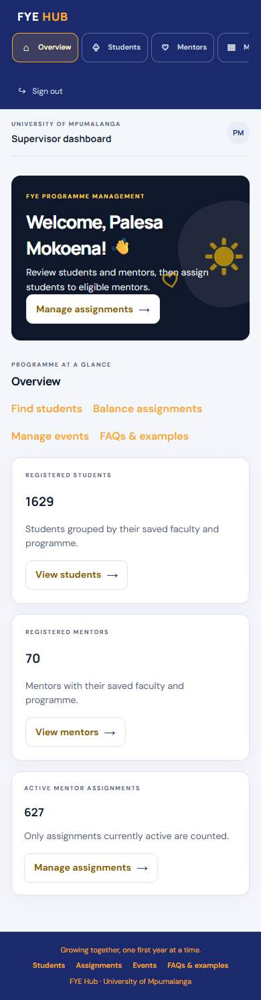
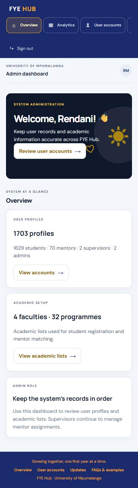
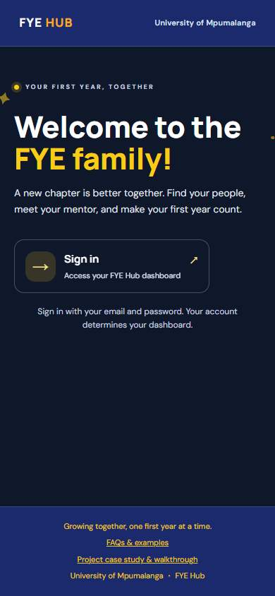

See [setup](SETUP.md#screenshots) to regenerate the captures.
