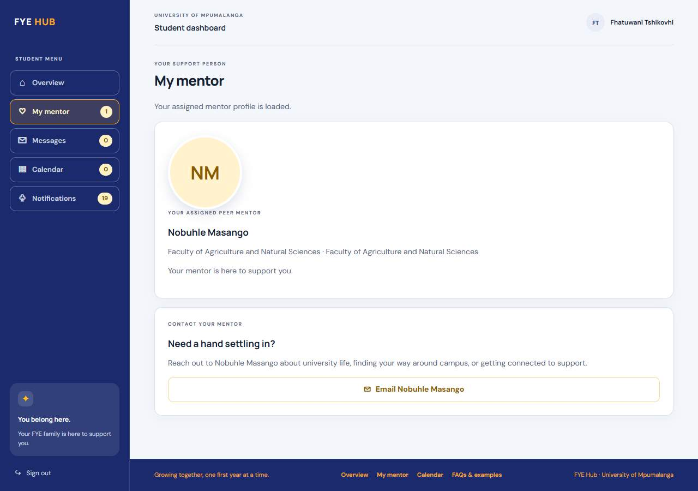
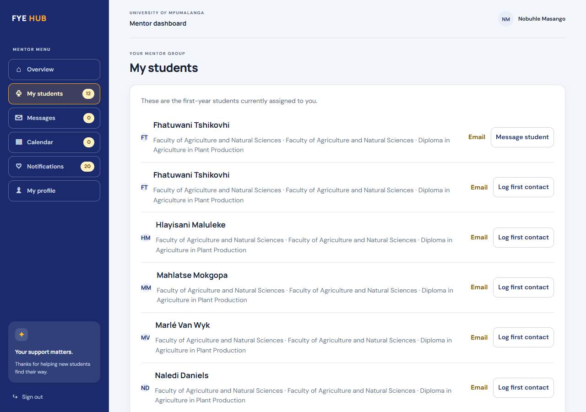
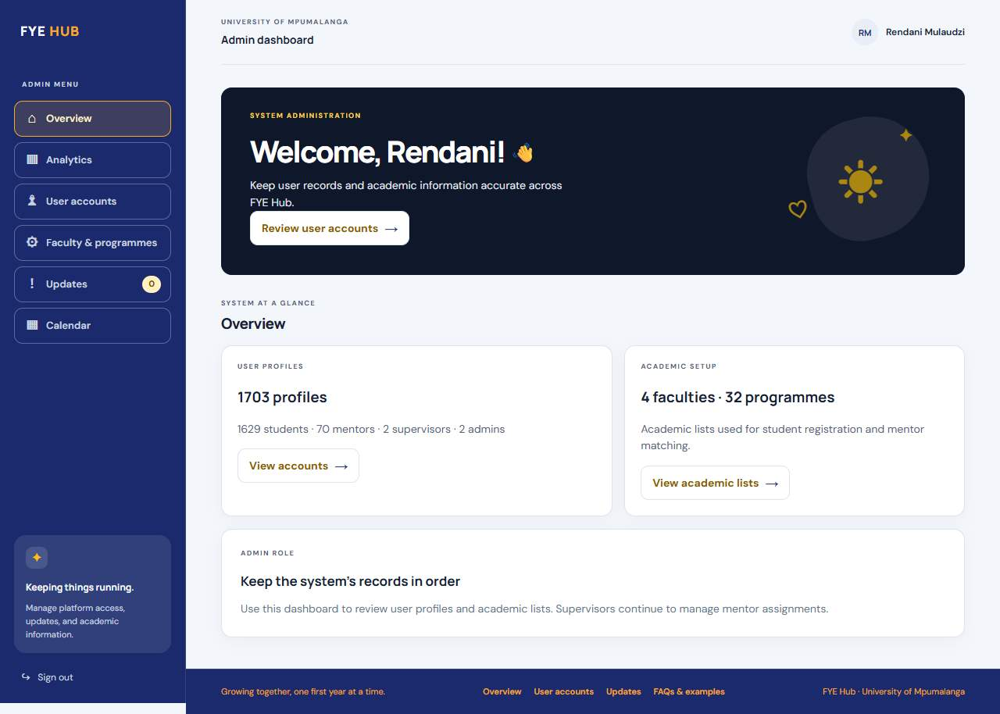
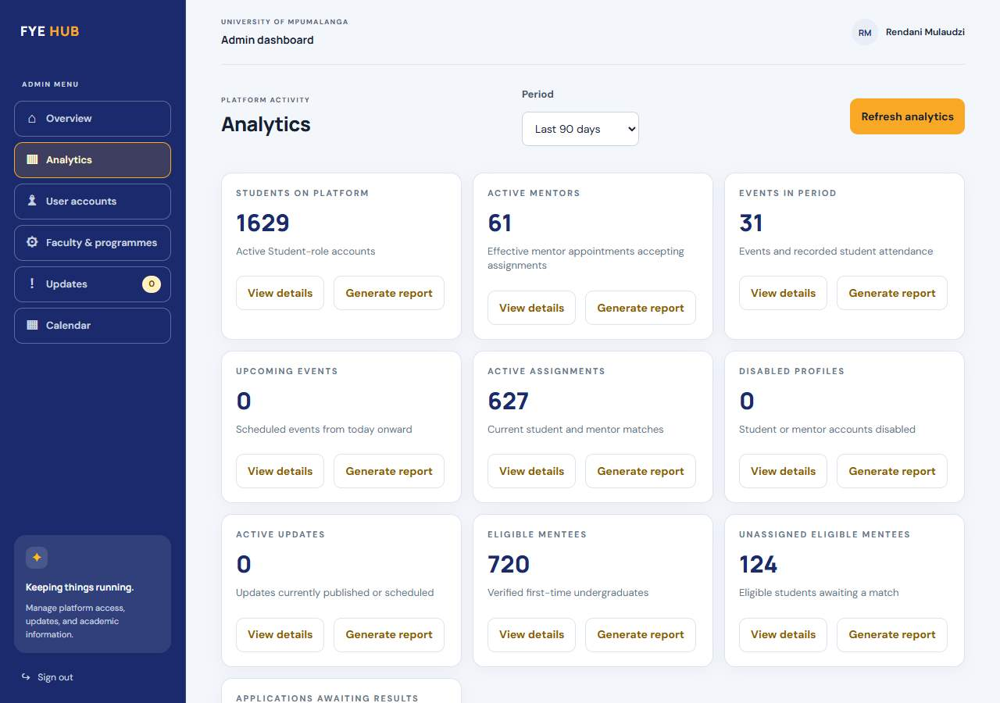
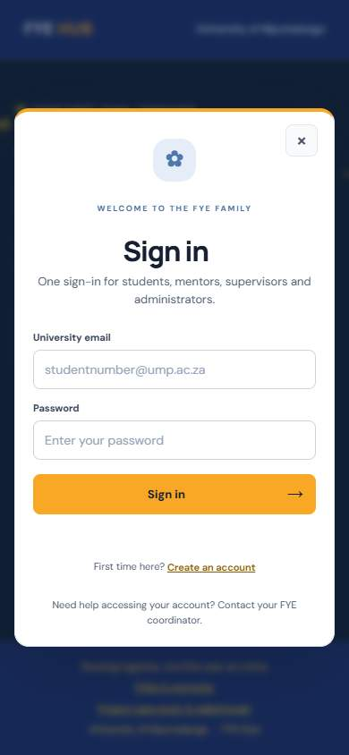
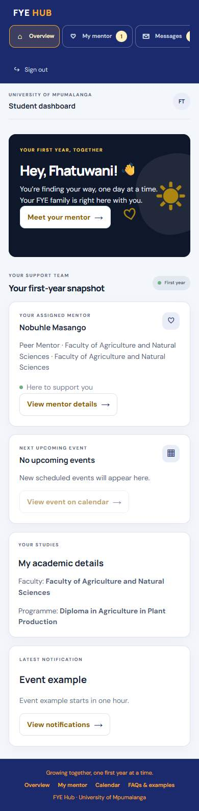

# Actual application screenshots

Captured on **7 November 2026** by running the project locally and opening its real pages in Microsoft Edge through Playwright. The application connected to its Supabase project. The capture signed in through the real login form using one existing demo account for each role from the private presentation-login CSV. These images contain actual rendered pages and populated prototype data, with no mocked backend responses, authentication bypasses, replacement dashboards, or generated UI. Database totals are prototype state, not evidence of real-world adoption.

## Student workspace

Signed-in overview with the assigned mentor and academic information:


Assigned mentor and available contact options:



## Mentor workspace

Signed-in overview and assigned-student count:


The mentor's assigned-student view:



## Supervisor workspace

Programme overview with student, mentor, and active assignment totals:


Assignment controls and current-match summary:


## Admin workspace

Account and academic structure overview:



Analytics loaded from the prototype database:



## Welcome screen

Desktop, 1280 × 900:


## Shared sign-in

The real application sign-in dialog, opened from the welcome screen. Fields are empty:


## Help and FAQs


## Mobile

Captured at a 390 × 844 viewport. Full-page images include content below the initial viewport:







## Reproduce the captures

Configure the project's public Supabase URL/key in the ignored `.env`, then run:

```sh
npm ci
npm run screenshots
```

To use an existing presentation-login CSV, set its private local path in the ignored `.env.screenshots`:

```dotenv
FYE_SCREENSHOT_LOGINS_CSV="C:/path/to/presentation-logins.csv"
```

The CSV should have `role`, `email`, and `password` columns. The first matching student, mentor, supervisor, and admin account is used. Keep this CSV outside public assets and source control.

Alternatively, supply individual test logins in the same ignored file:

```dotenv
FYE_STUDENT_EMAIL=
FYE_STUDENT_PASSWORD=
FYE_MENTOR_EMAIL=
FYE_MENTOR_PASSWORD=
FYE_SUPERVISOR_EMAIL=
FYE_SUPERVISOR_PASSWORD=
FYE_ADMIN_EMAIL=
FYE_ADMIN_PASSWORD=
```

Each configured account must be able to reach the matching dashboard through normal sign-in. Missing roles are skipped and reported. A configured account that cannot reach its ready dashboard stops the capture with an error. The script waits for rendered data rather than network silence because the actual application polls for updates. Use test records suitable for publication, and review images before committing them.

To recapture dashboards without the public pages:

```sh
npm run screenshots -- --dashboards-only
```

Add `--role=student`, `--role=mentor`, `--role=supervisor`, or `--role=admin` to target one workspace. Each workspace capture includes its desktop overview, one feature view, and mobile overview.

The script writes only screenshots into `docs/screenshots/`; passwords, browser storage, and sessions are never saved in the repository. Its browser uses Edge on Windows and Chromium elsewhere, with the same `PLAYWRIGHT_CHANNEL` override as the existing browser checks.

The independent portfolio presentation remains available, but it is not the source of these application screenshots.
